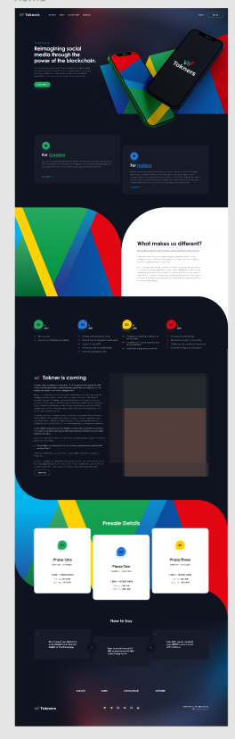
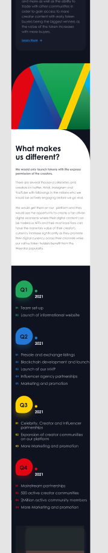
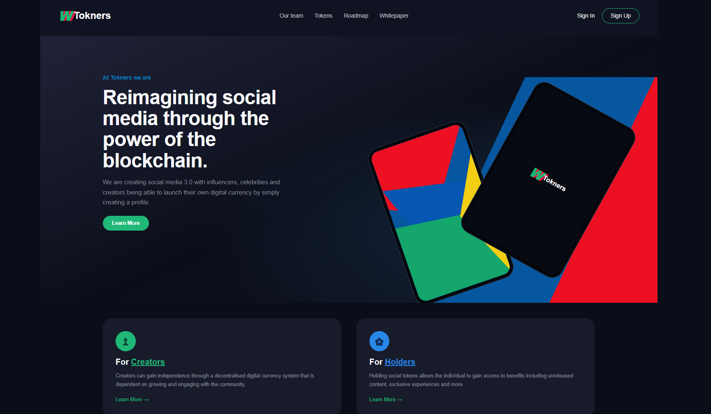

<div align="center">

# TOKNERS

### Reimagining Social Media Through Blockchain

A responsive landing page built with **HTML5** and **CSS3**.

<br>


</div>

---

## ✨ About the Project

**Tokners** is a responsive landing-page project inspired by a modern blockchain and creator-economy website. It presents a dark visual theme, vivid geometric artwork, and content sections designed to adapt to different screen sizes.

The project focuses on practicing semantic HTML, CSS layout techniques, and responsive design with media queries.

## 🖥️ Preview

> Add your own screenshots to the `screenshots` folder using the filenames shown below. The images will appear here once those files are added to the repository.

### Desktop



### Mobile



### Full-page view



---

## 🎨 Design Highlights

- **Dark visual theme** with navy backgrounds and bright accent colors.
- **Hero section** with a prominent headline, supporting text, call-to-action, and decorative phone mockups.
- **Creators and Holders cards** describing the platform's intended audience.
- **“What makes us different?” section** with bold geometric artwork.
- **Roadmap section** arranged into quarterly milestones.
- **Weentar section** with longer-form project content.
- **Presale details** presented in cards.
- **How to buy section** with numbered steps.
- **Footer** with social-link placeholders and copyright text.

## 📱 Responsive Layout

The stylesheet uses CSS media queries to adjust the layout for different viewport widths.

| Screen size | Layout approach |
|---|---|
| Small mobile | Single-column content and compact typography |
| Tablet | Two-column cards and more spacious sections |
| Desktop | Wider hero layout, multi-column roadmap, and three-column card sections |

The exact appearance depends on the browser viewport. Decorative illustrations are currently created with CSS shapes rather than external image assets.

## 🧰 Built With

- **HTML5** — semantic page structure and content.
- **CSS3** — Flexbox, CSS Grid, gradients, `clip-path`, and media queries.
- **Git and GitHub** — version control and project hosting.

No JavaScript framework is required for the current layout.

## 📂 Project Structure

```text
Tokners/
├── index.html
├── style.css
├── README.md
└── screenshots/
    ├── tokners-desktop.png
    ├── tokners-mobile.png
    └── tokners-full-page.png
```

## 🚀 Run Locally

1. Clone the repository:

   ```bash
   git clone https://github.com/EstherLogic/Tokners.git
   ```

2. Open the project folder:

   ```bash
   cd Tokners
   ```

3. Open `index.html` in your browser, or use the **Live Server** extension in VS Code.

## 📸 Add Your Screenshots

For the preview images to display on GitHub:

1. Create a folder named `screenshots` in the project root.
2. Capture the website at a desktop width and a mobile width.
3. Save the images with these exact names:
   - `tokners-desktop.png`
   - `tokners-mobile.png`
   - `tokners-full-page.png`
4. Add and push the files:

   ```bash
   git add README.md screenshots
   git commit -m "Add project README and screenshots"
   git push
   ```

If you only have two screenshots, remove the **Full-page view** image section until you add the third image.

## 🔍 What I Practiced

- Structuring a multi-section landing page with semantic HTML.
- Building layouts with Flexbox and CSS Grid.
- Creating decorative geometric visuals with CSS.
- Applying media queries for mobile, tablet, and desktop.
- Organizing styles into clear, maintainable sections.
- Using Git to track and publish project changes.

## 📌 Current Scope

This project currently focuses on the responsive front-end presentation. The navigation, call-to-action, and social links are visual placeholders and are not connected to backend services.

---

<div align="center">

**TOKNERS** · Responsive Web Design Practice

Built with HTML & CSS

</div>
